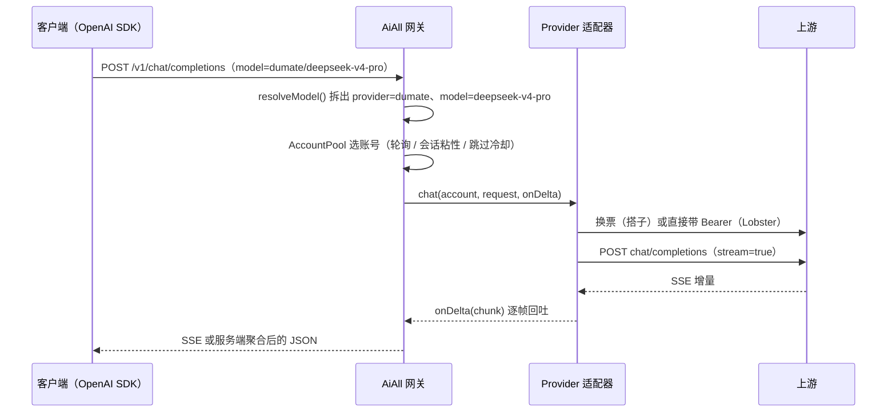
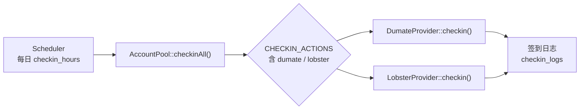

# 百度搭子 & 有道 LobsterAI 反代接入

> **文档导航**：[总目录](README.md) · [安装](installation.md) · [部署](deployment.md) · [配置](configuration.md) · [架构](architecture.md) · [API](api.md) · [供应商](providers.md) · [开发](development.md)

本文说明 AiAll 内置的 **百度搭子（`dumate`）** 与 **有道 LobsterAI（`lobster`）** 两个上游适配器：
凭据怎么取、账号怎么加、模型怎么同步、请求怎么发、额度与签到怎么跑、报错怎么查。

两者都是「网页版/客户端会话 → OpenAI 兼容接口」的**反代**实现：上游本身不提供开放 API，
AiAll 按浏览器与官方客户端的真实协议转发请求，因此接入前请先阅读 [§ 11 已知限制](#11-已知限制与合规提示)。

**本文导读**：[概览](#1-概览) · [请求链路](#2-请求链路) · [上游协议](#3-上游协议) ·
[获取凭据](#4-获取凭据) · [添加账号](#5-添加账号) · [同步模型](#6-同步模型) · [调用方式](#7-调用方式) ·
[额度与签到](#8-额度与签到) · [自检与排障](#9-自检与排障) · [参考项目](#10-与参考项目的关系) ·
[已知限制](#11-已知限制与合规提示)

---

## 1. 概览

| 项目 | 百度搭子 | 有道 LobsterAI |
| --- | --- | --- |
| 供应商 key | `dumate` | `lobster` |
| 展示名 | 百度搭子 | 有道 LobsterAI |
| 适配器 | `app/Provider/Providers/DumateProvider.php` | `app/Provider/Providers/LobsterProvider.php` |
| 登录方式 | `API_KEY`（实际填 **网页 Cookie**） | `API_KEY`（实际填 **accessToken**） |
| 上游主机 | `www.dumate.cn`、`dumate-svc.baidu.com` | `lobsterai-server.youdao.com`、`api-overmind.youdao.com` |
| 对话协议 | OpenAI 兼容（SSE / 非流式） | OpenAI 兼容（**仅 SSE**，由网关强制流式） |
| 图片输入 | 支持（多模态模型） | 不支持 |
| 模型来源 | 内置 22 个静态模型目录 | 动态拉取，失败回退 8 个静态模型 |
| 令牌续期 | Cookie 长期有效，网关 token 约 1 小时自动换票 | `accessToken` 过期用 `refreshToken` 刷新 |
| 签到 | 每日登录奖励（幂等） | 每日积分礼 +100（幂等） |

两者共用框架的账号池、限流、日志、计费与错误归一化，适配器只负责**换凭据、转请求、解析 SSE、归一化错误**。

---

## 2. 请求链路

### 2.1 对话



要点：

- **模型前缀**由网关解析，适配器收到的已经是**纯模型 ID**（如 `deepseek-v4-pro`），不需要自己剥前缀。
- **非流式请求**由网关在服务端聚合后一次性返回；因此即使上游只支持 SSE（Lobster），客户端也能用 `stream=false`。
- **失败重试**由账号池统一处理：鉴权失效 → 换号重试；额度耗尽 → 冷却该账号；模型不可用 → 直接失败并给出可读错误。

### 2.2 签到



`AccountPool::CHECKIN_ACTIONS` 已登记两个 key：

```php
'dumate'  => 'checkin',
'lobster' => 'checkin',
```

自动签到由后台设置 `auto_checkin` 控制（默认关闭），执行时点为 `checkin_hours`（默认 `9,21`）。

---

## 3. 上游协议

### 3.1 百度搭子

| 用途 | 方法与路径 | 关键请求头 / 参数 | 响应要点 |
| --- | --- | --- | --- |
| 换票 | `GET https://www.dumate.cn/api/dumate/app/token/get` | `Cookie`、`X-Dumate-Client-Type: web` | `result.token`、`result.expired_at` |
| 对话 | `POST https://dumate-svc.baidu.com/gateway/apis/v1/chat/completions` | `Authorization: Bearer <token>`、`X-Dumate-Client-Type: web`、`X-Dumate-Account-Id: global` | OpenAI 兼容 SSE |
| 额度 | `GET /api/dumate/points/quota_overview?clientType=desktop&timezone=Asia/Shanghai` | `Cookie` | `result.totalPoints / usedPoints / subscription / incremental` |
| 签到状态 | `GET /api/dumate/points/loginBonusInfo` | `Cookie` | `result.signInDays`（含今日即已签） |
| 领取奖励 | `POST /api/dumate/points/loginBonus` | `Cookie`，body 为 `{}` | 领取后再查一次复核 |

实现细节：

- **换票缓存**：token 与过期时间写入账号凭据（`token` / `token_expire_at`），提前 5 分钟自动换票；并发时最多重复换一次，不影响正确性。
- **签到幂等**：先查 `signInDays` 是否包含今天，已包含直接返回「今日已签到」；领取后**再查一次**确认，避免上游返回成功但实际未发放。
- **额度分桶**：`subscription` 映射为「体验套餐 / 订阅套餐」，`incremental` 按 `source` 映射为「每日登录 / 奖励积分 / 活动奖励」。

### 3.2 有道 LobsterAI

| 用途 | 方法与路径 | 关键请求头 / 参数 | 响应要点 |
| --- | --- | --- | --- |
| 对话 | `POST /api/proxy/v1/chat/completions` | `Authorization: Bearer <accessToken>`、`X-LobsterAI-Client-Capabilities`、`X-LobsterAI-Client-Version` | 仅 SSE |
| 模型 | `GET /api/models/available` | `firstKeyfrom`（默认 `official`）、可选 `uuid` / `userId` | `data[].modelId` |
| 额度 | `GET /api/user/profile-summary?firstKeyfrom=official` | 同上 | `data.totalCreditsRemaining`、`data.creditItems` |
| 活动槽位 | `GET /api/client-activities/slot` | `placement=desktop_sidebar`、`clientVersion`、`containerApiVersion=2`、`platform=win32` | `data.slotState`、`data.activity.activityCode` / `configRevision` |
| 签到状态 | `GET /api/client-activities/{code}/context?configRevision=` | 同上 | `data.state.claimedToday`、`data.state.rewardCredits` |
| 执行签到 | `POST /api/client-activities/{code}/actions/check_in` | `configRevision`、`idempotencyKey`、`payload: {}` | `code == 0` 视为成功 |
| 刷新令牌 | `POST /api/auth/refresh` | `refreshToken`、`firstKeyfrom`、`latestKeyfrom`、`version` | `data.accessToken` / `data.refreshToken` |

实现细节：

- **强制流式**：上游只接受 `stream=true`，适配器固定写入；客户端要非流式时由网关聚合。
- **版本探测**：签到活动按客户端版本下发，版本过旧会拿到 `slotState=empty`。适配器会实时读
  `https://api-overmind.youdao.com/openapi/get/luna/hardware/lobsterai/prod/update` 的 `data.value.version`，
  失败时回退内置版本 `2026.9.4`。
- **幂等键**：每次签到生成随机 `idempotencyKey`（`daily-check-in-<32 hex>`），重复提交不会重复发放。
- **自动续期**：`refreshToken()` 在令牌临期时调用刷新接口，返回的新 token 由框架写回凭据。

---

## 4. 获取凭据

### 4.1 百度搭子：网页 Cookie

1. 用浏览器打开 <https://www.dumate.cn> 并完成登录；
2. 按 `F12` 打开开发者工具 → **Network**；
3. 刷新页面，点任意一个 `dumate.cn` 的请求 → **Request Headers** → 复制 `Cookie` 的**整段值**；
4. 确认包含 `BDUSS` 与 `bce-user-info` 两项（缺一不可）。

> [!IMPORTANT]
> 必须是**网页版明文 Cookie**（形如 `BDUSS=xxx; bce-user-info=yyy; ...`）。
> 桌面客户端本地存的是加密值，直接粘贴会换票失败。

Cookie 有效期较长，一般无需定期更换；若出现「取 token 失败（HTTP 401/403）」，重新登录并复制新 Cookie 即可。

### 4.2 有道 LobsterAI：accessToken

任选一种方式：

- **客户端数据库**：LobsterAI 客户端本地库 `kv` 表的 `auth_tokens` 记录中取 `accessToken`（同一条记录通常也含 `refreshToken`）；
- **抓包**：打开客户端后抓取其请求，复制 `Authorization: Bearer <accessToken>` 中 `Bearer` 之后的部分。

`accessToken` 是 JWT，会过期。**建议同时填写 `refreshToken`**，让网关自动续期；只填 accessToken 时，过期后需要重新粘贴。

可选项（不填也能用，填了更贴近官方客户端行为）：

| 字段 | 用途 |
| --- | --- |
| `refreshToken` | 自动续期 |
| `uuid` | 客户端安装标识，参与部分接口的签名/风控 |
| `firstKeyfrom` / `latestKeyfrom` | 渠道标识，默认 `official` |
| `userId` | 部分接口需要的用户标识 |

---

## 5. 添加账号

### 5.1 控制台（推荐）

1. 登录管理后台或用户控制台；
2. 进入 **账号管理** → **添加账号**；
3. 供应商选择 **百度搭子** 或 **有道 LobsterAI**；
4. 按弹窗提示粘贴 Cookie / accessToken（Lobster 可展开填写可选字段）；
5. 点 **校验并保存**（或弹窗底部「保存账号」，两者等价）。

保存前会先向上游校验：

- 搭子：调用 `token/get` 换票，失败直接返回「Cookie 校验失败：…」；
- Lobster：调用 `/api/models/available`，`401/403` 返回「accessToken 校验失败（HTTP …）：…」。

校验通过才落库，避免存入失效凭据、直到第一次对话才报错。

### 5.2 API

两个供应商的 `login_type` 都是 `API_KEY`，但凭据放在 `credential` 字段里提交：

```bash
# 百度搭子
curl -X POST "$AIA_URL/api/admin/accounts" \
  -H "Cookie: aigw_session=<管理员会话>" \
  -H "Content-Type: application/json" \
  -d '{
    "provider_key": "dumate",
    "credential": { "cookie": "BDUSS=xxx; bce-user-info=yyy; ..." },
    "nickname": "搭子主号"
  }'
```

```bash
# 有道 LobsterAI
curl -X POST "$AIA_URL/api/admin/accounts" \
  -H "Cookie: aigw_session=<管理员会话>" \
  -H "Content-Type: application/json" \
  -d '{
    "provider_key": "lobster",
    "credential": {
      "accessToken": "eyJhbGciOi...",
      "refreshToken": "可选",
      "uuid": "可选",
      "firstKeyfrom": "official"
    },
    "nickname": "Lobster 主号"
  }'
```

> 用户控制台把路径换成 `/api/user/accounts`，凭据自动归属当前用户，只能看到自己的账号。

### 5.3 凭据结构与幂等

| 供应商 | 账号 UID | 落库字段 |
| --- | --- | --- |
| 百度搭子 | `dm_` + `sha256(cookie)` 前 16 位 | `cookie`、`token`、`token_expire_at` |
| 有道 LobsterAI | `lb_` + `sha256(accessToken)` 前 16 位 | `accessToken`、`refreshToken`、`uuid`、`firstKeyfrom`、`latestKeyfrom`、`userId` |

- 凭据整体经 `Crypto::encryptArray()`（AES-256-GCM，密钥来自 `AIGW_APP_KEY`）加密后落库；
- UID 由凭据哈希派生，**同一凭据重复添加会更新原账号**，不会产生重复行；
- 未填昵称时自动命名为 `搭子-xxxxxx` / `Lobster-xxxxxx`。

---

## 6. 同步模型

账号添加后，还需要把上游模型目录同步进 `aigw_model`，否则 `/v1/models` 不会列出、按裸模型名调用也无法路由。

**控制台**：模型管理 → 选择供应商 → **同步模型**。

**API**：

```bash
curl -X POST "$AIA_URL/api/admin/models/sync" \
  -H "Cookie: aigw_session=<管理员会话>" \
  -H "Content-Type: application/json" \
  -d '{"provider_key":"dumate"}'
```

- 搭子：直接使用内置静态目录，返回 `拉取 22 个模型，新增 22 个，更新 0 个`；
- Lobster：实时拉取 `/api/models/available`；接口异常时回退 8 个静态模型，仍可完成同步。

> 同步需要一个**可用账号**来提供凭据。没有账号时会提示「该供应商下没有可用账号，无法拉取模型」。

---

## 7. 调用方式

### 7.1 模型命名

对外模型 ID 统一为 **`供应商前缀/上游模型 ID`**：

```text
dumate/deepseek-v4-pro
dumate/qwen3.8-max
lobster/deepseek-v4-pro
lobster/kimi-k3
```

前缀默认等于 `provider_key`；`/v1/models` 返回的 `id` 与 `call_name` 就是这个可直接回填的调用名。
同名模型（如 `deepseek-v4-pro` 两个上游都有）**必须带前缀**才能确定走哪个平台。

### 7.2 调用示例

```bash
curl "$AIA_URL/v1/chat/completions" \
  -H "Authorization: Bearer $AIA_KEY" \
  -H "Content-Type: application/json" \
  -d '{
    "model": "dumate/deepseek-v4-pro",
    "messages": [{"role": "user", "content": "用一句话解释什么是反向代理"}],
    "stream": true
  }'
```

```python
from openai import OpenAI

client = OpenAI(base_url=f"{AIA_URL}/v1", api_key=AIA_KEY)

resp = client.chat.completions.create(
    model="lobster/kimi-k3",
    messages=[{"role": "user", "content": "你好"}],
    stream=True,
)
for chunk in resp:
    if chunk.choices and chunk.choices[0].delta.content:
        print(chunk.choices[0].delta.content, end="")
```

`stream=false` 同样可用：Lobster 上游只支持 SSE，网关会在服务端聚合后一次性返回。

### 7.3 百度搭子模型清单（22 个）

| 模型 ID | 上下文 | 最大输出 | 多模态 |
| --- | ---: | ---: | :-: |
| `deepseek-v4-pro` | 1,000,000 | 384,000 | |
| `deepseek-v4-flash-0731` | 200,000 | 32,000 | |
| `deepseek-v41-flash` | 1,000,000 | 384,000 | ✓ |
| `dm-auto-model/mm.L0` | 1,000,000 | 384,000 | ✓ |
| `dm-auto-model/mm.L1` | 1,000,000 | 384,000 | ✓ |
| `dm-auto-model/mm.L2` | 1,000,000 | 384,000 | ✓ |
| `dm-auto-model/text.L0` | 1,000,000 | 384,000 | |
| `dm-auto-model/text.L1` | 1,000,000 | 384,000 | |
| `dm-auto-model/text.L2` | 1,000,000 | 384,000 | |
| `doubao-seed-2-0-pro` | 128,000 | 32,000 | |
| `ernie-4.5-turbo-vl-32k` | 32,000 | 8,192 | ✓ |
| `glm-53` | 128,000 | 32,000 | |
| `glm-53-flash` | 128,000 | 32,000 | |
| `kimi-k3` | 256,000 | 32,000 | |
| `kimi-k31` | 256,000 | 32,000 | |
| `model-text` | 128,000 | 32,000 | |
| `qwen2.5-vl-32b-instruct` | 32,000 | 8,192 | ✓ |
| `qwen3.5-27b` | 128,000 | 32,000 | |
| `qwen3.5-35b-a3b` | 128,000 | 32,000 | |
| `qwen3.5-397b-a17b` | 128,000 | 32,000 | |
| `qwen3.8-max` | 200,000 | 32,000 | |
| `qwen38-flash` | 200,000 | 32,000 | |

> 目录维护在 `DumateProvider::MODEL_META`。上游新增模型时，改这一处常量再重新同步即可；
> 模型名含 `pro` 的会在目录里标记为 `reasoning`。

### 7.4 有道 LobsterAI 模型

优先取 `/api/models/available` 的实时结果。接口不可用时的兜底清单（8 个）：

```text
deepseek-v4-pro
deepseek-v4-flash
deepseek-v41-flash
kimi-k3
kimi-k3-agentic-v1
glm-53
qwen3.8-max
qwen38-flash
```

Lobster 不支持图片输入：带 `image_url` 的请求会被适配层直接拒绝为 `400 unsupported_image_input`，
而不是把图片静默丢掉。

---

## 8. 额度与签到

### 8.1 额度

| 供应商 | 数据来源 | 展示口径 |
| --- | --- | --- |
| 百度搭子 | `points/quota_overview` | 总量 / 已用 / 剩余，并按 `subscription`（体验/订阅）与 `incremental`（每日登录/奖励/活动）分桶 |
| 有道 LobsterAI | `user/profile-summary` | `totalCreditsRemaining` 总剩余，`creditItems[].label` 分桶 |

查询失败不会让账号不可用，只会记为「额度未知」（`CreditInfo::unknown()`），并写一条 warn 日志。

### 8.2 签到

| 供应商 | 流程 | 成功提示 |
| --- | --- | --- |
| 百度搭子 | `loginBonusInfo` → 判断今日 → `loginBonus` → 再查复核 | `签到成功` / `今日已签到` |
| 有道 LobsterAI | `slot` → `context` → `check_in`（带幂等键） | `签到成功，获得 100 积分` / `今日已签到` |

触发方式：

- **自动**：后台设置开启 `auto_checkin`，每天 `checkin_hours`（默认 `9,21`）由调度器执行；
- **手动（按供应商）**：`POST /api/admin/accounts/checkin-all`，body `{"provider":"dumate"}`；
- **手动（单账号）**：`POST /api/admin/accounts/{id}/action`，body `{"action":"checkin"}`；
- **强制重签**：`checkin-all` 带 `force` 时跳过「今日已签」判断（一般不需要）。

每次签到都会写入签到日志，可在「签到日志」页按供应商筛选追溯。

---

## 9. 自检与排障

### 9.1 「自检」做了什么

账号列表的「自检 / 连通性」按钮会调用 `action('test')`：

| 供应商 | 探针内容 | 成功返回 |
| --- | --- | --- |
| 百度搭子 | Cookie 换票 + **真实对话**（`model-text`，`max_tokens=1`，非流式） | `连通正常（Cookie 换票 + 对话网关均可用）` |
| 有道 LobsterAI | 拉模型 + **真实对话**（流式，收到首帧即中断） | `连通正常（accessToken + 对话网关均可用）` |

只验 token 无法发现「token 有效但模型网关不可用」，所以两个探针都真的打了一次上游对话。
Lobster 上游只支持 SSE，探针在收到第一帧后主动中断，尽量少耗额度。

### 9.2 常见报错对照

| 提示 | 含义 | 处理 |
| --- | --- | --- |
| `Cookie 为必填` | 请求没带 Cookie（多为走了旧的保存路径） | 升级到当前版本；在弹窗内粘贴 Cookie 后点「校验并保存」 |
| `Cookie 校验失败：取 token 失败（HTTP 401/403）` | Cookie 过期，或粘贴的是客户端加密 Cookie | 重新登录网页版，复制完整明文 Cookie |
| `Cookie 校验失败：取 token 失败：…` | 上游返回了业务错误（风控/未登录） | 按提示信息处理，必要时换网络环境重登 |
| `百度搭子账号缺少 Cookie，请重新登录` | 账号记录里没有 Cookie | 删除账号重新添加 |
| `accessToken 为必填` | 未填写 token | 粘贴 JWT 后重试 |
| `accessToken 校验失败（HTTP 401/403）` | token 过期或已被吊销 | 重新取 accessToken；建议同时填 `refreshToken` |
| `有道 LobsterAI 账号缺少 accessToken，请重新登录` | 账号记录里没有 token | 删除账号重新添加 |
| `当前无每日积分礼活动` | 活动未开放，或客户端版本过旧导致 `slotState != available` | 属于上游策略，稍后再试；适配器已自动探测最新版本 |
| `签到未成功：…` | 领取接口返回非成功 | 看提示信息；若为「已领取」可忽略 |
| `模型 xxx 在上游触发了用量频率限制` | 上游 429 | 换模型或等重置；账号池会自动冷却 |
| `供应商 xxx 当前没有可用账号` | 账号全部冷却/停用 | 查看账号状态，解除冷却或补充账号 |

### 9.3 排查顺序

1. 点「自检」——先确认凭据与对话网关都能通；
2. 点「同步模型」——确认 `/v1/models` 能看到 `dumate/...` 或 `lobster/...`；
3. 用 `curl` 打一次 `/v1/chat/completions`——区分是网关问题还是客户端问题；
4. 看 `storage/logs/php-error.log` 与调用日志——适配器的 warn 日志带 `uid` 与上游 message。

---

## 10. 与参考项目的关系

协议细节参考了以下开源项目（均为 MIT）：

| 环节 | dumate2api | lobsterai2api | AIAutomator | AiAll 落地 |
| --- | --- | --- | --- | --- |
| 换票 / 鉴权 | `src/dumate-web-api.js` | `internal/auth/auth.go` | `platforms/dumate.py`、`dumate_crypto.py` | `DumateProvider::fetchToken()` / `appToken()` |
| 对话转发 | `src/web-gateway.js` | `internal/upstream/client.go` | `platforms/lobster.py` | 两个 `chat()` |
| 模型目录 | `dumate-catalog.default.json` | `classify.go` | — | `MODEL_META` 常量 / `models()` 动态拉取 |
| 签到 | `src/dumate-web.js` | — | `hooks/lobster_checkin.py` | 两个 `checkin()` |

AiAll 中的实现是**按协议重写的 PHP 代码**，未引入上述项目的运行时依赖（Node/Go/Python），
也没有复制其源码；仅参考了接口路径、请求头与字段语义。

---

## 11. 已知限制与合规提示

**技术限制**

1. 两个上游都是**非公开接口**，路径、请求头、字段可能随官方版本更新而变化；出现集体失败时优先怀疑上游改版。
2. Lobster **只支持流式**，网关已强制 `stream=true` 并在服务端聚合非流式请求，因此首字延迟会比原生流式略高。
3. Lobster **不支持图片输入**；搭子的图片能力取决于所选模型是否多模态。
4. 搭子的模型目录是**静态常量**（22 个）。上游新增模型需更新 `MODEL_META` 后重新同步，不会自动发现。
5. 签到依赖上游活动配置：活动下线、版本门槛变化都会导致「当前无每日积分礼活动」，这不是网关故障。
6. 两个适配器的单元级验证（类加载、模型目录、动作返回结构、PHP 语法）已进 CI；
   **真实对话与真实签到需要你自己的账号**，仓库内不含任何凭据，也无法替你做端到端验证。

**合规提示**

- 仅可用于**你自己拥有或已获授权**的账号，不要用于账号池买卖、代充或规避上游风控；
- 上游用户协议通常限制「非官方客户端访问」，使用前请自行确认风险；
- 本项目的 AGPL-3.0 许可与上游条款相互独立，遵守其一不代表遵守另一；
- 因使用本适配器导致的账号封禁、额度损失等后果由使用者自行承担。
